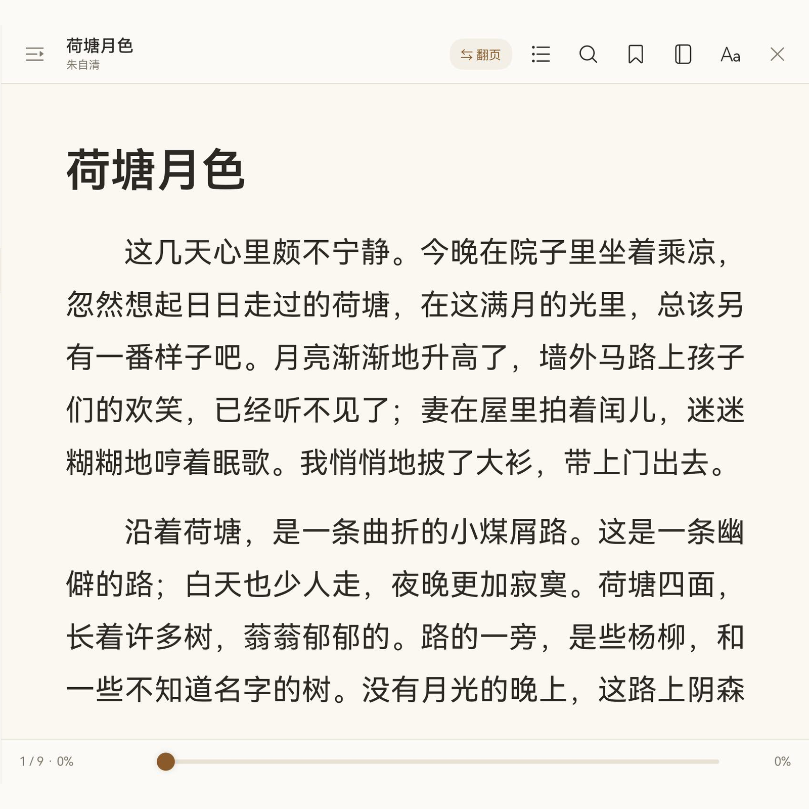

# EasyRead for HarmonyOS

EasyRead 是一款面向 HarmonyOS 平板、2-in-1 与手机的本地电子书阅读器，使用 ArkTS / ArkUI 原生实现。书籍由你自行导入，不提供在线书城；本地书库、WebDAV 书库与多设备同步等全部功能免费开放。

EasyRead is an independent, native HarmonyOS ebook reader. Every feature is free, including the WebDAV library and sync. This repository and its releases contain source code only.

> **没有可直接下载安装的 HAP。** HarmonyOS 目前不支持 HAP 侧载，安装包必须使用华为开发者证书和匹配的 profile 签名。GitHub Release 仅提供源码；请在 DevEco Studio 中按「构建与安装」自行签名构建。仓库内不包含任何证书、签名 profile 或签名口令。

同一作者的 macOS 版：[KBDZequalsCK/EasyRead](https://github.com/KBDZequalsCK/EasyRead)

第一次使用？安装、书架导入、阅读操作、WebDAV 同步和常见问题见 **[使用说明](docs/user-guide.md)**。



## 功能

- **本地书库**：从系统文件选择器导入书籍，或关联一个本地文件夹作为书库；不扫描整个存储空间。
- **多种格式**：EPUB、TXT、PDF、MOBI、AZW、AZW3、FB2、CBZ 漫画、RTF、DOCX、Markdown。
- **阅读体验**：纸白、米黄、浅绿、夜间四种主题，衬线、黑体、楷体、系统字体，字号、行距、页边距、左右分页与上下滚动、单栏与双栏。
- **书籍结构**：目录、书签、笔记、阅读进度、章节进度；EPUB 可选保留出版社样式。
- **本地优先**：书籍、封面、阅读进度、书签、笔记和设置保存在应用沙箱；断网时本地功能完整可用。
- **WebDAV 书库**：连接坚果云、Nextcloud 或通用 WebDAV，合并云端书籍，上传、下载并双向合并阅读进度。支持 EasyRead 与 ZenReader（极简阅读兼容）两种同步目录。
- **全部免费**：没有应用内购买、订阅、授权码或账号；没有广告、统计、推送或社交 SDK，也没有开发者服务器。

## 全部功能免费

本地书库、导入、阅读、书签、笔记、本地文件夹、WebDAV 云端书架与多设备同步都可以直接使用，不需要购买、解锁或登录。

应用不包含支付 SDK，不读取设备标识，不提供任何付费入口；WebDAV 数据只发送到你填写的服务器。

## 构建与安装

> 本仓库只提供源码，**不提供预签名 HAP**，也不提供签名服务。HarmonyOS 不允许像 Android APK 那样自由侧载：安装包必须使用华为开发者证书和匹配的 profile 签名，且真机调试通常需要把设备加入调试 profile。

### 环境

- DevEco Studio 26.0.0（HarmonyOS SDK API 26）
- 设备系统 API 12 及以上
- 一个可用的华为开发者签名配置（DevEco 自动签名或你自己的证书）

### 步骤

1. 克隆仓库：

   ```bash
   git clone https://github.com/KBDZequalsCK/EasyRead-Harmony.git
   cd EasyRead-Harmony
   ```

2. 用 DevEco Studio 打开项目目录。
3. 打开 **File → Project Structure → Signing Configs**，启用 **Automatically generate signature**，按提示登录华为账号并连接设备；或配置你自己的证书、profile 与密钥。
4. 选择 `entry` 模块，点击 **Run** 构建并安装。

命令行构建需要先配置签名，然后在项目根目录执行 hvigor。如果 `hvigorw` 不在 `PATH` 中，可使用 DevEco Studio 自带的版本（macOS 默认路径如下）：

```bash
/Applications/DevEco-Studio.app/Contents/tools/hvigor/bin/hvigorw \
  assembleHap --mode module -p product=default -p module=entry@default -p buildMode=debug --no-daemon
```

仓库中的 `build-profile.json5` 特意不包含任何 `signingConfigs`、证书路径或口令，请勿把自己的签名材料提交到公开仓库。

正式对外分发 HarmonyOS 应用仍需通过华为应用市场，或使用华为允许的测试、企业内部渠道。

## 项目结构

```text
AppScope/                         应用级配置与图标
entry/src/main/ets/
  pages/Index.ets                 书架、阅读器与设置界面
  service/
    BookService.ets               书籍导入、解析与缓存
    FolderService.ets             本地文件夹书库
    WebDavClient.ets              WebDAV 协议客户端
    ZenSyncService.ets            书库与阅读进度同步
    SettingsStore.ets             设置、隐私同意与同步配置
  parser/                         EPUB/TXT/PDF/MOBI/FB2/CBZ/RTF/DOCX/Markdown
  components/                     主题与隐私政策
docs/user-guide.md                使用说明
docs/privacy-policy.md            隐私政策
docs/screenshots/                 README 截图
samples/                          可用于试用的公有领域样书
```

## 样例书籍

`samples/` 中包含六本由脚本生成的 EPUB 样书，正文均为公有领域中文作品，可直接导入试用：

- 朱自清《背影》《荷塘月色》
- 鲁迅《故乡》
- 老舍《济南的冬天》
- 蘅塘退士编《唐诗选》
- 王国维《人间词话》

生成脚本为 `samples/make_books.py`，需要 Pillow 与 macOS 系统字体；EPUB 已随仓库提供，无需重新生成。

## 隐私

EasyRead 不收集 IMEI、OAID 等广告标识，也不读取 ODID 或其他设备标识；不进行用户画像、统计分析或广告投放，不含广告、统计、推送、社交或支付 SDK。

- 书籍、阅读进度、书签、笔记和设置只保存在应用沙箱。
- WebDAV 账号、应用密码或令牌只保存在本机，仅发送给你填写的 WebDAV 服务器。
- 没有开发者服务器，应用不会把你的书库或账号上传给开发者。

完整说明见 [隐私政策](docs/privacy-policy.md)。

## 许可证

源代码以 [MIT License](LICENSE) 发布，Copyright © 2026 kbdz。

`samples/` 中的作品为公有领域文本，EPUB 由本仓库脚本生成；截图为本应用界面截图。

## 反馈

问题与建议：<https://github.com/KBDZequalsCK/EasyRead-Harmony/issues>